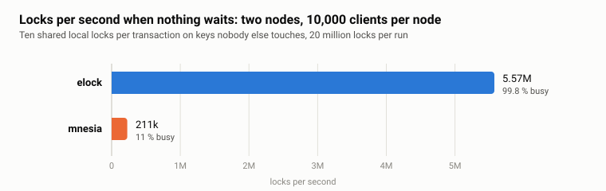

# elock: scalable distributed locks with deadlock detection

*Locks are cheap, waiting for them is not. Take the waiting out and your only limit is your cores. [elock](https://github.com/vzroman/elock) is a lock library for Erlang: locks on any term, exclusive or shared, on one node or on several at once, with deadlocks detected across nodes, and a happy path that waits for nobody.*



Requires Erlang/OTP 27 or later. The cross-node traffic rides [ecall](https://github.com/vzroman/ecall), which rebar3 fetches as a dependency.

- [What elock does](#what-elock-does)
- [Installation and startup](#installation-and-startup)
- [Scopes and nodes](#scopes-and-nodes)
- [API](#api)
- [Semantics and limits](#semantics-and-limits)
- [Tests](#tests)
- [License](#license)

## What elock does

The library is small, and the part that decides the numbers is smaller.

**A lock is an ETS row, and a ticket is the only synchronization.** A scope is a public ETS table. A lock on a term is a row in it: the term, the pid of its manager and a counter. To ask for the lock, the caller increments the counter (the monitor and the retry of the real code are left out):

```erlang
lock(#request{scope = Scope, term = Term} = Request, OnQueued) ->
  case ets:update_counter(Scope, Term, {3, 1}, {Term, 0, 0}) of
    1 ->
      % the row was free: the caller holds the lock from this moment
      Manager = start_manager(Request),
      {ok, Manager};
    Ticket ->
      % somebody holds it: queue behind them, in ticket order
      Manager = get_manager(Scope, Term, Ticket),
      Manager ! Request#request{ticket = Ticket, proxy = self()},
      wait_verdict(Manager, OnQueued, Request)
  end.
```

Ticket 1 means the row was free: the caller holds the lock the moment the counter returns and spawns a manager for the term. Any later ticket means somebody holds it: the caller sends its request to the manager and waits for a verdict, `locked`, `timeout` or `deadlock`. The uncontended path is one atomic counter update in the caller, about 17 µs of scheduler time, and it is why both nodes were at 99.8 percent in the figure above: every core was taking locks, because nothing stood in the way.

**A manager per locked term, for as long as it is locked.** The manager keeps the queue in ticket order and grants in that order. A shared request joins the shared holders at once only while nobody is waiting, so a stream of readers cannot starve a writer. When the last holder leaves and nobody waits, the manager deletes the row and exits. Contention on a hot term is one process on one scheduler; two hot terms are two processes on two schedulers.

**A request for several nodes is one worker per node, over ecall.** The caller spawns a worker per node, and each worker asks its node through `ecall`, the batched transport that takes the distribution queue out of the way. All nodes are asked at once; the request holds the nodes that have granted it while it waits for the rest, and if any node fails the granted ones are released, so the result is all or nothing. After a remote grant the worker stays alive on the caller's node as the holder of that lock: it monitors the caller and sends the release when the caller exits.

**Deadlock detection is off the happy path.** Only a request that has to wait while its process already holds something can deadlock, and only such a request pays for detection. It gets a graph worker, spawned when the manager reports it queued and never before. The worker publishes the process's holds into a wait-for graph that every node keeps in a public ETS table, and every new edge starts a walk from it, expanding locks on their own node and hopping to the other nodes with one cast per node. A walk that comes back to its origin has found a cycle, and the request of the younger context loses: it gets `{error, {deadlock, Lock}}`, keeps what it holds, and the caller decides, typically release and repeat. A walk has a limit on the locks it visits, past which the origin loses with `probe_limit` rather than let the walk become the cost.

**Locks die with their holder.** A local holder is monitored by its manager, a remote one by its worker, and every node drops the locks of the clients of a node that has gone down. A process that crashes while holding locks leaves no lock behind.

The figure above is the happy path. How it was measured, how mnesia and global did on the same workloads, and the four designs the production system went through on the way to it, are in [the article](docs/article.md).

## Installation and startup

Add elock as a rebar3 dependency:

```erlang
{deps, [
  {elock, {git, "https://github.com/vzroman/elock.git", {branch, "main"}}}
]}.
```

elock is an OTP application. List it in your application's dependencies so that the release boot script, or `application:ensure_all_started/1`, starts it before your code runs; it brings ecall with it:

```erlang
%% myapp.app.src
{application, myapp, [
  ...
  {applications, [kernel, stdlib, elock]},
  ...
]}.
```

The application starts one process per node, the wait-for graph `elock_graph`. The locks live in scopes, and a scope is started by you: add it to a supervisor of yours as a permanent worker, on every node that is to keep locks of the scope.

```erlang
#{
  id => my_locks,
  start => {elock, start_link, [my_locks]}
}
```

Then take a lock, do the work and release the lock in the same process:

```erlang
{ok, Ref} = elock:lock(my_locks, {account, 42}, [node()]),
try
  withdraw(42, Amount)
after
  elock:unlock(Ref)
end.
```

A shared lock on every node of the scope, waiting for it at most 5 seconds:

```erlang
Nodes = elock:ready_nodes(my_locks),
Options = #{is_shared => true, timeout => 5000},
case elock:lock(my_locks, {account, 42}, Nodes, Options) of
  {ok, Ref} ->
    Balance = balance(42),
    elock:unlock(Ref),
    {ok, Balance};
  {error, Reason} ->
    {error, Reason}
end.
```

elock has no application environment parameters. The transport is configured through ecall's `pool_size` and `batch_size`, see [its configuration](https://github.com/vzroman/ecall#configuration).

## Scopes and nodes

A scope is an independent set of locks named by an atom. On a node it is one public ETS table with the name of the scope, so the name must not be the name of another named table. The same term in two scopes is two locks, and so is the same term on two nodes: two requests compete only on the nodes that both of them name. If you need another independent set of locks, start another scope under a different name.

elock does not form the cluster. It relies on Erlang distribution being connected already, by `net_adm:ping/1`, `-connect_all`, a cluster library, or whatever you use. On top of that, the nodes of a scope find each other through `pg`: the scope process on every node joins a `pg` scope of its own, named after the scope, and `elock:ready_nodes/1` lists the nodes that are in it. The local node is in the list if the scope is started on it, and the list is empty if it is not. The other nodes join the list as they start the scope and leave it when they stop it or disconnect, so the list follows the cluster with a delay. Use it to build the `Nodes` of `lock/4`:

```erlang
1> elock:ready_nodes(my_locks).
['a@host','b@host','c@host']
```

A lock lives on the node it was taken on. If that node goes down, or the scope stops there, the lock is lost and its holder is not notified; the locks the holder has on the other nodes stay until it unlocks them. A request for a node that can not be reached or does not run the scope fails as a whole, see `lock/4`.

## API

The `elock` module is the whole public API. The other modules of the application, `elock_scope`, `elock_manager`, `elock_context` and `elock_graph`, are implementation details. `Scope` is the atom a scope was started with, `Term` is any Erlang term, `Nodes` is a non-empty list of node names which may include the local node.

### `start_link/1`

```erlang
{ok, Pid} = elock:start_link(my_locks).
```

Starts the scope `Scope` on the local node and links it to the caller. Meant to be a permanent worker of a supervisor, see [Installation and startup](#installation-and-startup). The locks of the scope can be taken on this node while the returned process is alive. When it exits, the locks taken on this node are lost.

The second start of a scope on a node returns `{ok, Pid}` as well, but that process exits at once with `badarg`.

### `lock/3`

```erlang
{ok, Ref} = elock:lock(my_locks, {account, 42}, [node()]).
```

The same as `lock(Scope, Term, Nodes, #{})`: an exclusive lock on every node of `Nodes`, waited for without a timeout.

### `lock/4`

```erlang
Options = #{is_shared => true, timeout => 5000},
{ok, Ref} = elock:lock(my_locks, {account, 42}, ['a@host', 'b@host'], Options).
```

Locks `Term` in `Scope` on every node of `Nodes` and returns the reference to release it with `unlock/1`. The call returns when the lock is held on all the nodes or the request has failed. Duplicates in `Nodes` are ignored.

`Options` is a map with two optional keys:

| key | values | default | meaning |
|---|---|---|---|
| `is_shared` | `true`, `false` | `false` | `true` for a shared lock, `false` for an exclusive one |
| `timeout` | milliseconds, `undefined` | `undefined` | how long the request may wait for the lock on a node; `undefined` waits without a limit |

The results:

- `{ok, Ref}`: the calling process holds the lock on every node of `Nodes`.
- `{error, timeout}`: the request has waited on a node for longer than the `timeout`. A request that does not have to wait never times out.
- `{error, {deadlock, {Scope, Term, Node}}}`: the request has lost a deadlock to a request that waits for the named lock. See [Deadlocks](#deadlocks).
- `{error, {deadlock, probe_limit}}`: the search for a deadlock reached its limit. Handle it as a deadlock.
- `{error, {badrpc, Reason}}`: a node of `Nodes` can not be reached.
- `{error, {exit, badarg}}`: the scope is not started on a node of `Nodes`. If `Nodes` is the local node alone, the call raises `badarg` instead.

After an error the request holds nothing on any node, and the locks the process already held are untouched.

Invalid arguments are thrown, not returned: `{invalid_nodes, Nodes}` unless `Nodes` is a non-empty list, `{invalid_node, Node}` for a node that is not an atom, `{invalid_options, Options}` unless `Options` is a map, `{invalid_option, Key}` for an unknown key, `{invalid_is_shared, Value}` and `{invalid_timeout, Value}`.

```erlang
{ok, Ref} = elock:lock(my_locks, Key, ['a@host', 'b@host'], #{}),
{error, timeout} = elock:lock(my_locks, Busy, [node()], #{timeout => 100}),
{error, {deadlock, {my_locks, _, _}}} = elock:lock(my_locks, Other, [node()]).
```

### `unlock/1`

```erlang
ok = elock:unlock(Ref).
```

Releases the lock taken as `Ref` on all its nodes and returns at once. It must be called by the process that took the lock. A reference that is unknown, already unlocked or taken by another process is ignored, so the call always returns `ok`.

### `ready_nodes/1`

```erlang
Nodes = elock:ready_nodes(my_locks),
{ok, Ref} = elock:lock(my_locks, {account, 42}, Nodes).
```

Returns the nodes where `Scope` is started, as the local node sees them. See [Scopes and nodes](#scopes-and-nodes).

### Deprecated forms

```erlang
{ok, Unlock} = elock:lock(my_locks, {account, 42}, false, 5000),
ok = Unlock(),
{ok, UnlockAll} = elock:lock(my_locks, {account, 42}, true, infinity, ['a@host', 'b@host']),
ok = UnlockAll().
```

`lock(Scope, Term, IsShared, Timeout)` and `lock(Scope, Term, IsShared, Timeout, Nodes)`, with a boolean as the third argument, are the API of the previous versions, kept for compatibility. They take the same locks as `lock/4`, with these differences:

- The result is `{ok, Unlock}`, and the lock is released by calling `Unlock()` in the process that took it.
- `Timeout` is in milliseconds or `infinity`. With `0` the call returns `{error, timeout}` without asking for the lock.
- A deadlock is reported as `{error, deadlock}`.
- The four-argument form locks on the local node only. An empty `Nodes` in the five-argument form locks nothing and returns `{ok, Unlock}`.

### Summary

| function | waits for | success | failure |
|---|---|---|---|
| `start_link/1` | nothing | `{ok, Pid}` | the process exits with `badarg` |
| `lock/3` | the exclusive lock on every node | `{ok, Ref}` | `{error, Reason}` |
| `lock/4` | the lock on every node, at most `timeout` per node | `{ok, Ref}` | `{error, Reason}` |
| `unlock/1` | nothing | `ok` | never fails |
| `ready_nodes/1` | nothing | `[node()]` | never fails |

## Semantics and limits

### Locks

- Any term can be locked. Terms are compared with `=:=`, so `1` and `1.0` are different locks.
- An exclusive lock has one holder. A shared lock has any number of holders and keeps the exclusive requests waiting.
- The requests for a lock are served on each node in the order they arrive. A shared request joins the shared holders at once only while nobody waits, so a stream of shared requests does not starve an exclusive one.
- A lock belongs to the process that took it, and only that process can release it. The locks of a process are released and its waiting requests are withdrawn when it exits.
- A request for several nodes is all or nothing: it succeeds when every node has granted it, and when it fails the nodes that have granted it are released. While it waits for some nodes it holds the others.

### Re-entrancy

A process can lock a term it already holds. Every successful call returns a reference of its own, and the term is released when all of them are unlocked.

- A holder asking for the same mode is granted at once.
- An exclusive holder asking for shared is granted at once as well, and the lock stays exclusive until the exclusive reference is unlocked.
- A shared holder asking for exclusive is an upgrade. It waits for the other shared holders to leave and goes ahead of the queue. If two holders upgrade the same lock, the second gets `{error, {deadlock, Lock}}` at once and keeps its shared lock.

### Deadlocks

Processes that wait for each other's locks in a cycle are detected, within a scope, across scopes and across nodes. At least one request of the cycle fails with `{error, {deadlock, {Scope, Term, Node}}}`, which names the lock the winning request waits for.

- A request of a younger context loses to a request of an older context. The context of a process starts with its first lock request while it holds nothing and ends when it releases its last lock. Equal ages are settled by a coin.
- The loser keeps the locks it holds, and the others keep waiting for them. To let them through, release those locks and then repeat the request.
- A request can also fail with `{error, {deadlock, probe_limit}}`, without a cycle, when the search for one exceeds its limit. The limit is `(10 + Age div 100) × Holds` visited locks, clamped between 100 and 10,000, where `Holds` is the number of locks the context holds and `Age` its age in milliseconds. Handle it as a deadlock.
- Two processes that lock the same term on the same several nodes at the same time may get a part of the nodes each. That is a deadlock as well, so a request for several nodes can lose while its process holds nothing.
- One cycle may cost more than one request: the verdicts are made independently, so several requests of a cycle issued at the same moment can lose, more often as the cycle gets longer.
- A request can lose to a cycle that has just dissolved. As after a real deadlock, the loser keeps its locks and the caller repeats the request.

Detection is paid only by a request that has to wait while its process holds something. A request that is granted at once, or that waits while holding nothing, never touches the graph.

### Failures

- A lock lives on the node it was taken on. If that node goes down, or the scope stops there, the lock is lost and its holder is not notified. The locks the holder has on the other nodes stay until it unlocks them.
- A request fails as a whole when one of its nodes can not be reached or does not run the scope.
- A process that exits while holding locks releases them on every node, and a node drops the locks of the clients of a node that has gone down.

### Cost

- An uncontended lock is one ETS counter update in the caller, and its release one message to the manager. Nothing is serialized across terms.
- Contention on one term is one manager process. A hot term is one scheduler's worth of work, however many clients wait for it.
- A lock on another node is a round trip. More clients put more round trips in flight; they do not shorten one. Keep the cross-node locks for the rare path and hold no lock across a round trip or a long computation, since everything behind it waits with you.

## Tests

The repository has two independent test layers: functional suites that run on one machine, and a distributed performance suite that drives nodes in Docker containers and produces the JSON behind the figure above and the article.

```sh
make test                # functional suites
make performance_tests   # distributed performance suite
make performance_report  # build and serve the report over the collected runs
```

### Functional tests

```sh
make test
```

Runs `./rebar3 ct --spec test/functional/test.spec`, ten Common Test suites in three stages:

- The per-module suites: `elock_test_utils_SUITE` (the shared test helpers), `elock_SUITE` (the client API, the context of a client process and the scope, against fake managers and fake nodes), `elock_graph_SUITE` (the per-node graph table, publications and captured walks), `elock_probe_limit_SUITE` (context lifetime and the walk limit) and `elock_manager_SUITE` (the manager's protocol and state transformations).
- The single-node scenarios: `elock_locking_SUITE` (modes, queue order, re-entrancy and upgrades, timeouts, the death of clients and managers), `elock_deadlock_SUITE` (cycles, verdicts and their order) and `elock_concurrency_SUITE` (stress scenarios with hundreds of clients).
- The multi-node scenarios: `elock_multi_node_SUITE` (acquisitions, contention, deadlocks, failure cleanup and scope membership across nodes) and `elock_multi_node_concurrency_SUITE` (stress scenarios on three nodes, including a node killed under load).

The multi-node suites start `peer` nodes on this host with the code paths of the build, so `epmd` must be available. The sizes of the stress scenarios are in [test/functional/functional.config](test/functional/functional.config). The functional tests reach the internals of the modules, so the test profile compiles with `export_all`. Logs go to `_build/test/logs`.

rebar3 ignores `--suite` next to `--spec` and runs the whole spec; to run one suite use the directory form:

```sh
./rebar3 ct --dir test/functional --suite elock_graph_SUITE
```

### Performance tests

```sh
make performance_tests
```

Runs `./rebar3 ct --spec test/performance/test.spec`. The machine running this command is the *controller*: it does not generate load itself. It starts every node of the configuration as a `peer` node inside a Docker container, connects them, starts ecall on each and connects it in both directions, and then runs the configured paths, `elock`, `mnesia` and `global`, one after another over the same workload. The clients run on every node.

#### Requirements

- Docker on the controller and on every host named in `nodes`, usable by the invoking user.
- The base image `erlang:27.2.2` in the local Docker image store. The suite never pulls: if it is missing the run fails with `{base_image_missing, ...}`, because the hosts these tests were written for have no registry access. Side-load it there (`docker save` / `docker load`) before the first run.
- For remote nodes, `sshpass` and password SSH access for the user in `nodes`.
- Erlang distribution reachable between the controller and the nodes. Containers run with `--network host`; the controller listens on port 4443 and the nodes on 4443 plus their index in the sorted order of the role names, with a cookie the controller generates.

On each run the controller rebuilds the image `elock-performance:otp27` from the working tree, so the nodes always run the code you have. Set `ELOCK_PERFORMANCE_PREBUILT_IMAGE=true` to use the image already in the store instead. For a remote node the controller compares the image ID on the host with the local one and, if they differ, streams the image over SSH (`docker save | gzip | ssh … docker load`), which takes a few minutes the first time.

#### Configuring a run

[test/performance/performance.config](test/performance/performance.config) holds three terms.

**`nodes`** says where the nodes run, by role name. `local` puts the container on the controller machine, with the node named `<role>@127.0.0.1`. A map puts it on another host over SSH, and then the node name is taken from the config, so it must match the host the container runs on. `local => true` in the map runs Docker locally without SSH while keeping the configured node name, for the host that is the controller itself:

```erlang
{nodes, #{
  node1 => #{
    host => "host1.example",
    node => "elock@host1.example",
    user => "user",
    password => "password"
  },
  node2 => #{
    host => "host2.example",
    node => "elock@host2.example",
    user => "user",
    password => "password"
  }
}}.
```

Note that `performance.config` is a plain file in the repository and the remote form keeps the SSH password in clear text; keep real credentials out of commits.

All nodes local is the quick way to check that a change runs at all; it measures loopback and nodes competing for the same cores, not distribution. Everything in the article was measured with two remote nodes on two separate hosts.

**`performance`** is one fixed workload. Every key is required; there are no defaults:

| key | meaning |
|---|---|
| `clients_per_node` | clients on every node |
| `transactions_per_client` | transactions a client runs |
| `objects_pool_size` | the keys are drawn from this many objects, shared by every client and node |
| `transaction` | `#{read => R, update => U, write => W}`: `R + U + W` operations on distinct keys per transaction; reads take shared locks, updates and writes exclusive ones |
| `read_ms` | simulated cost of a read, paid under its lock |
| `write_ms` | simulated cost of an update or write, paid once at commit for all of them while every lock is held |
| `timeout` | the lock timeout in milliseconds, or `undefined`; ignored by mnesia, which uses its own transactions |
| `restart_ms` | pause after a failed elock or global attempt before the plan is retried in full |
| `pacing_ms` | fixed length of a transaction cycle; the client idles for the rest of it, so the offered load is `nodes × clients_per_node × 1000 / pacing_ms` transactions per second; `0` starts every transaction at once |
| `seed` | every client seeds its own random state from `{seed, NodeIndex, ClientIndex}`, so every path replays the same plans |
| `deadlocks` | `false` locks the keys of a transaction in sorted order, `true` in random order |
| `unique_keys` | `true` locks a fresh reference per operation, so nothing is ever shared; `objects_pool_size` and `deadlocks` do not apply then |
| `paths` | which engines run, from `[elock, mnesia, global]` |
| `global_max_locks` | global runs only for zero reads, sorted order and at most this many held locks, `nodes × clients_per_node × (R + U + W)` |

In this workload a read is a shared lock on the local node and an update or a write an exclusive lock on every node of the run: the designs of the article are ten reads for design 4, one update for designs 1 and 2, and ten updates in random order for design 3.

**`env_settings`** configures the nodes:

| key | effect |
|---|---|
| `ecall_batch_size` | `batch_size` in the ecall application environment on every node, before ecall is started |
| `distribution_busy_limit_kib` | `+zdbbl` on every node |

```erlang
{env_settings, #{
  ecall_batch_size => 1000,
  distribution_busy_limit_kib => 1024
}}.
```

The nodes also get `+P 134217727`, `+Q 1048576` and `+e 262144` so that the large client counts fit, and the containers are started with `nofile=1048576`.

Every path writes a point as `performance_data/<path>.json` in the private directory of the suite under `_build/test/logs`.

### Performance report

```sh
make performance_report
```

Installs, builds and serves the report at `http://localhost:3000` over every point found under `_build/test/logs`; the paths of one run are compared side by side. [performance_report/README.md](performance_report/README.md) describes the report and defines its metrics in detail.

| metric | source |
|---|---|
| locks/s, transactions/s | over the elapsed time of the point: on the node that takes longest, from the start of its first client to the last transaction of its latest client |
| transactions/s per client | the mean over the clients of a client's transactions over its own span |
| lock time share, % | the transaction time less the measured work of the committing attempt, over the transaction time |
| restarts | failed attempts on elock and global, mnesia's own restarts |
| memory | total memory of a node at the start of the point and its peak |
| scheduler utilization, % | per node, over the point |
| max run queue | longest run queue seen on a node |
| network | distribution bytes sent to the other nodes of the run |

## License

MIT.
