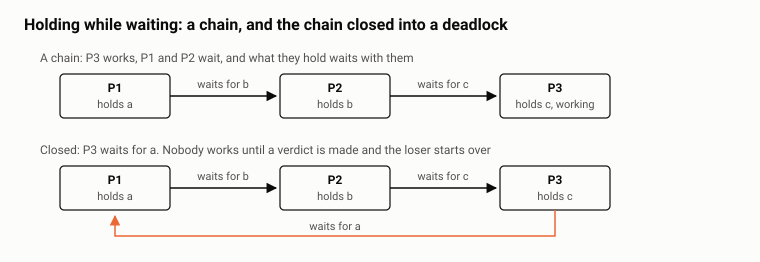

# Elock - locks are cheap, waiting is not: four lock designs for the same writes, 95k to 5.5M locks per second on two nodes

*Locks are not the cost. Waiting for them is. A process that waits does no work, holds what it already has, and makes the next process wait too. We built a lock library that keeps the happy path inside the caller, and then found that the library was the smaller half of the answer. The larger half was deciding which locks never need to wait: four designs of the same write path on two nodes, from 95 thousand to 5.5 million locks per second.*

## Where we left off

The [previous article](https://erlangforums.com/t/ecall-batched-pooled-send-cast-call-over-erlang-distribution-scales-past-the-single-output-queue-per-node-pair/5940) was about the distribution output queue, one per node pair, entered once per message, and about the batched, pooled transport that got the SCADA/EMS system we built for KEGOC, Kazakhstan's national electricity grid operator, past it. In the discussion that followed, [a question from cmo](https://erlangforums.com/t/ecall-batched-pooled-send-cast-call-over-erlang-distribution-scales-past-the-single-output-queue-per-node-pair/5940/9) made us [describe what the system is made of](https://erlangforums.com/t/ecall-batched-pooled-send-cast-call-over-erlang-distribution-scales-past-the-single-output-queue-per-node-pair/5940/10), and that description is the starting point here.

The unit of information is a tag, a record in a database engine with subscriptions, never a process. The processes are the actors that read and write tags: a device connection per PLC or meter, a user script, an archive, a user session per browser, and the high-level services, the state estimation engine, the grid graph, the AI dispatcher assistant. Almost every actor is both a producer and a consumer, and a write on one node is shipped to the neighbours and fanned out to the subscribers there.

Writes are not the only traffic. Actors have to synchronise over the tags they write, so there are locks, and every lock that spans nodes goes over the same channel as the writes. The demand we had to meet: about 5 million objects, about 10,000 actors, and 200,000 keys written per second across the cluster. That is the number every design below is measured against.

The library is [elock](https://github.com/vzroman/elock): locks on any Erlang term, exclusive or shared, on one node or on several at once, with deadlocks detected across nodes. The designs below are the ways we used it, in the order we tried them.

## The problem: waiting instead of working

### What a lock costs is the wait, not the lock

A lock that is granted at once costs a few ETS operations and a message or two. On the hardware below that is some tens of microseconds of scheduler time, and the process goes straight on with its work.

A lock that has to wait costs the whole wait. The process does nothing useful for its duration, and that is only the direct cost. While it waits it keeps everything it has already locked, so any process that needs one of those locks waits as well, holding its own locks in turn. That is a chain. The time lost is the sum over the chain, and the chain is built by processes that are, from the outside, all busy.



A chain that closes on itself is a deadlock. Nobody in it will ever proceed on their own; something has to detect it and choose a loser, and the loser has to give up its locks and start over. The cost is everything the whole chain waited, plus the lost attempt, plus the restart. None of this needs a second node. Chains and deadlocks are a single-node phenomenon that distribution makes slower, not a distribution phenomenon.

### The price list

Not all locks wait the same. A shared lock on the local node is granted at once whenever no exclusive request is waiting, and shared holders never wait for each other. An exclusive lock on the local node waits only when somebody else holds the term. An exclusive lock on several nodes is a request to each node, a grant from each, and the wait for the slowest of them, with the granted nodes held in the meantime. Every one of those signals goes through the distribution queue of the previous article, behind every other signal that is waiting there.

Measured in the runs described below, per lock, at 10,000 clients per node:

| lock | wait per lock | scheduler time per lock |
|---|--:|--:|
| shared, local, nobody waiting | 3 ms | 17 µs |
| exclusive, on both nodes | 208 ms | 226 µs |

The scheduler time is `busy share × 48 schedulers × elapsed / locks`, summed over both nodes, the way the previous article computed it. The 3 ms of the first row is not the lock waiting at all: it is 10,000 runnable clients sharing 48 cores, the time a client spends in the run queue between its locks. The 208 ms of the second row is waiting, nearly all of it in the channel between the nodes.

Two rungs, nearly two orders of magnitude apart in time and one in scheduler work. The design question is not which lock engine to use. It is how many of your locks sit on the expensive rung, and how long your chains are.

## The benchmark

The same two hosts as before: two Xeon Gold 6342 sockets each, 48 cores with hyper-threading off, 251 GiB of RAM, a 10 GbE bond between them, Ubuntu 22.04. Each node runs in a Docker container with host networking from the official `erlang:27.2.2` image, and a third machine drives the run through Common Test. The suite is in the repository under `test/performance`.

The workload is a population of clients, 10,000 per node unless said otherwise, over a pool of 5 million objects. Each client runs its transactions back to back with no pause. A transaction is a plan of keys drawn by a seeded generator, so every path replays exactly the same plans, then the locks for them, then the release. There is no simulated write: the transaction time is the lock time. When a lock request fails, the client releases what it holds and runs the same plan again; such an attempt is counted as a restart, and it costs nothing but the lost attempt. That is deliberately generous to every path, and we come back to it.

Three paths lock the same plans:

- **elock.** A scope on both nodes. A write takes an exclusive lock on the key on both nodes, a read takes a shared lock on the local node. A request that loses a deadlock or times out fails the attempt.
- **mnesia.** A `ram_copies` table on both nodes, the plan as `mnesia:lock/2` calls on records inside `mnesia:transaction/1`. Mnesia restarts a transaction itself when its locker refuses a lock; those restarts are counted.
- **global.** `global:set_lock/3` on both nodes for each key, from a process that owns the locks for the transaction.

Counted: transactions and locks per second, the average transaction time, the share of transactions restarted, and per node the scheduler utilization, the peak memory, the maximum run queue and the bytes sent on the network, as in the previous article. Mnesia and global are there as the reference points every Erlang programmer knows, not as competitors on the same design: we use mnesia for other things, and global was never meant for this load.

## Design 1: one exclusive lock on both nodes, per write

The simplest thing that is correct. Each actor, for each key it writes, takes an exclusive lock on both nodes, writes, releases. 10,000 clients per node, 1,000 transactions each, one key per transaction: 20 million locks.

| path | keys/s | avg transaction | restarted | scheduler busy | peak memory | max run queue |
|---|--:|--:|--:|--:|--:|--:|
| elock | 95,642 | 208 ms | 0.15 % | 24 % | 2.6 GB | 3,054 |
| mnesia | 21,671 | 897 ms | 1.3 % | 54 % | 4.2 GB | 5,734 |
| global | did not finish | | | | | |

elock delivers about half of the demand, mnesia a tenth. global did not complete the point and was stopped.

The column that says what is going on is the scheduler one. At 95,000 locks per second the nodes are three quarters idle. Nothing is computing; 20,000 clients are waiting, each for its own lock to make the round trip, and the throughput is simply the number of waiters divided by the wait: 20,000 clients over 0.208 s is 96,000 per second, the measured figure to within half a percent. The ceiling of this design is not the lock engine and not the CPU. It is concurrency divided by latency.

Where the 208 ms go: the lock traffic rides ecall, the batched transport of the previous article, and the channel is nowhere near saturated in bytes, 4.7 GB per node over 209 s. The wait is queueing. A request takes its turn in the proxies and in the distribution queue behind every other request, on both legs, and the release goes the same way. At 10,000 clients per node a lock takes 208 ms because thousands of other requests are in front of it.

The restart share is small but not zero. With one key per transaction there is no order to get wrong, but two clients on different nodes asking for the same key at the same moment can each be granted their own node first, which is a deadlock as well, and one of them starts over.

## Design 2: ten times the clients

If the ceiling is concurrency divided by latency, raise the concurrency. 100,000 clients per node, 100 transactions each, the same 20 million locks.

| path | keys/s | avg transaction | restarted | scheduler busy | peak memory | max run queue |
|---|--:|--:|--:|--:|--:|--:|
| elock | 307,275 | 616 ms | 1.5 % | 77 % | 5.5 GB | 34,630 |
| mnesia | 15,791 | 12.5 s | 7.7 % | 62 % | 10.6 GB | 19,033 |

elock meets the demand with half as much again to spare. Little's law holds again: 200,000 clients over 0.616 s is 325,000 per second, six percent above the measured figure, the difference being the ramp at the start and the tail at the end. And the channel got cheaper per lock as it got busier: 173 bytes per lock per node against 233 in design 1, because ecall's batches grow with the backlog. That is the self-balancing of the previous article, seen from the consumer's side.

mnesia went the other way. Ten times the concurrency gave a quarter less throughput, transactions of 12 seconds on average and two minutes at the maximum, 1.5 million restarts, and 10 GB of memory per node.

So design 2 works, on paper. We did not take it. Ten times the actors is not a parameter, it is a rewrite of the system: the device connections, scripts and archives would have to be split into pieces that have no reason to exist except to lock in parallel. And the headroom is 54 percent over a demand that is a floor, on a channel whose cost we had just finished learning. The schedulers are already at 77 percent and the run queue peaks at 34,000. There is not much left for the system to do its actual work with.

## What elock does

The library is small, and the part of it that decides the numbers above is smaller. Here is the whole idea.

### 1. A lock is an ETS row, and a ticket is the only synchronization

A scope is a public ETS table. A lock on a term is a row in it: the term, the pid of its manager, and a counter. To ask for the lock, the caller increments the counter. The clause, with the monitoring and retry details removed:

```erlang
lock(#request{scope = Scope, term = Term} = Request, OnQueued) ->
  case ets:update_counter(Scope, Term, {3, 1}, {Term, 0, 0}) of
    1 ->
      % the row was free: the caller holds the lock from this moment
      Manager = start_manager(Request),
      {ok, Manager};
    Ticket ->
      % somebody holds it: queue behind them, in ticket order
      Manager = get_manager(Scope, Term, Ticket),
      Manager ! Request#request{ticket = Ticket, proxy = self()},
      wait_verdict(Manager, OnQueued, Request)
  end.
```

Ticket 1 means the row was free. The caller holds the lock the moment the counter returns, and spawns a manager for the term, which writes its pid into the row. Any later ticket means somebody holds the term: the caller sends its request to the manager and waits for a verdict, `locked`, `timeout` or `deadlock`. There is no locker process to go through. The uncontended path, which is the path a well-designed system takes almost all the time, is one atomic counter update in the caller. That is the 17 µs of the price list, and it is why both nodes were at 99.8 percent busy in design 4: every core was taking locks, because nothing was in their way.

### 2. A manager per locked term, for as long as it is locked

The manager is a process per term, not per node. It keeps the queue in ticket order, grants in that order, lets a shared request join the shared holders at once only while nobody is waiting, so that a stream of readers cannot starve a writer, and answers timeouts. When its last holder leaves and nobody waits, it deletes the row and exits, unless a ticket was taken in the meantime, in which case it stays. Contention on a hot term is one process on one scheduler, and two hot terms are two processes on two schedulers. Its mailbox is `off_heap`, for the reason the previous article gave for the pool processes.

### 3. A request for the local node never leaves the caller

A request for `[node()]` is the code above, run by the caller itself. No worker, no message to anybody but the manager, and the manager only if the term is taken.

### 4. A request for several nodes is one worker per node, over ecall

A request for several nodes spawns a worker per node, and each worker calls `elock_manager:lock/2` on its node through `ecall_connection:call/4`, the batched channel. All nodes are asked at once. The request holds the nodes that have granted it while it waits for the rest, and when any node fails, the granted ones are released, so the result is all or nothing. A worker whose node is remote stays alive after the grant as that lock's representative on the client's node: it monitors the client and sends the release when the client exits. The traffic is batched, which is why design 2 could carry 307,000 lock round trips per second over one node pair. It is still a round trip, which is why design 1 waited 208 ms for it.

### 5. Deadlock detection is off the happy path

A request that has to wait while its process already holds something is the only one that can deadlock, and the only one that pays for detection. Such a request gets a graph worker, spawned when the manager reports it queued and never before. The worker publishes the process's holds on the node of the lock it waits for, into a wait-for graph that every node keeps in a public ETS table. Every new edge starts a walk from it: the walk expands locks on their own node and hops to the other nodes with one cast per node, carrying the set of locks already visited. A walk that comes back to the origin has found a cycle, and a verdict is made: the request of the younger context loses, where the context of a process begins with its first lock while holding nothing and ends when it releases its last. The loser gets `{error, {deadlock, Lock}}` naming the lock the winner waits for, keeps what it holds, and the caller decides what to do, typically release and repeat. A walk has a limit on the locks it visits, past which the origin loses with `probe_limit` rather than let the walk itself become the cost. The verdicts are made independently, so a long cycle can lose more than one request. A walk is cheap next to what it prevents, and it is not free. Design 3 is what that looks like.

### 6. Locks die with their holder

A local holder is monitored by the manager. A remote holder is represented by its worker, which monitors it locally and sends the release, and every node drops the locks of the clients of a node that has gone down. A process that crashes while holding locks leaves no lock behind. That is a correctness property in a lock library. In design 4 it turned out to be a feature.

## Design 3: batches, in random order

Back to 10,000 clients, with the thought that a transaction of ten keys is cheaper to write than ten transactions of one, which for the store is true. Each client locks its ten keys exclusively on both nodes, in the order it comes to need them, which for a real actor is not known in advance and for the benchmark is random, then writes, then releases. 100 transactions per client, the same 20 million locks.

| path | keys/s | tx/s | avg transaction | restarted | scheduler busy | peak memory |
|---|--:|--:|--:|--:|--:|--:|
| elock | 88,287 | 8,829 | 2.2 s | 1.0 % | 17 % | 3.2 GB |
| mnesia | 79,714 | 7,971 | 2.5 s | 29.8 % | 4 % | 2.8 GB |

elock's lock rate held, eight percent below design 1. The transaction did not: 2.2 seconds on average against 208 ms for a single lock, eleven seconds at the maximum. That is the chain. A transaction that has six of its ten locks and waits for the seventh holds six keys that other transactions are waiting for, and they hold theirs. One percent of transactions hit a cycle and were restarted; the rest paid for the chains. The schedulers were idle at 17 percent while it happened.

mnesia's locker prevents deadlocks instead of detecting them: a younger transaction that asks for a lock held by an older one is restarted. Under random-order batches that rule fires constantly, and it restarted 30 percent of all transactions, 595,000 of them, at a scheduler cost of 4 percent, because a restarted transaction does nothing but wait and try again. The harness makes a restart free. A production system does not: a restarted transaction has done its reads, perhaps its computation, and does them again.

This is where we stopped believing in a better lock engine. Design 3 is a system that builds chains by construction. elock handled it better than mnesia, and it was still a system that wrote 88,000 keys per second while keeping two nodes 83 percent idle.

## Design 4: lock the piece of work, not the keys

The way out was in the shape of the traffic, which we had described in the forum thread before we used it. About 99 percent of the writes come from the heavy runtime services, the device connections, the calculations, the user scripts, each producing derived values for a set of tags that is known in advance and does not overlap with any other service's set. The remaining writes come from the occasional writers: a user changing a setpoint, the state estimation engine, the grid graph, an AI agent. Those can touch any key, including the keys a heavy service owns, so the heavy services and the occasional writers still have to synchronise. Heavy services do not have to synchronise with each other at all, by construction.

So the lock that has to be taken across nodes is not the lock on a key. It is the lock on a piece of work.


**Ownership by lock.** Every node starts every configured service. On start, each service asks for an exclusive lock on its service object, the PLC connection object, the script object, on every node of the scope. The service that gets the lock keeps it and does the work for its set of tags. The service that does not get it waits inside the request, holding nothing. The request is a loop: when it returns an error, because a node went away or the scope on it stopped, the service re-reads the ready nodes of the scope and asks again. One cross-node exclusive lock per service, once, at start.

**Heavy writes under shared local locks, in batches.** A service writes its tags under a shared lock on each key, on its own node only, and writes in batches. Shared, because the only conflict a heavy write can have is with an occasional writer, and shared holders never wait for each other. Local, because that is where the occasional writer's exclusive request will arrive. Between occasional writes, which is nearly always, the service's shared requests are granted at once, by the caller itself, in the 17 µs of the price list.

**Occasional writes under exclusive locks on every node.** An occasional writer takes an exclusive lock on each key it writes, on every node. On the heavy service's node it queues behind the shared holders of that key and is granted when they release; the service's next shared request on that key queues behind it, because a shared request joins at once only while nobody waits. That is the whole synchronisation between the two kinds of writer, and it is paid by the rare one.

The benchmark of the heavy path: 10,000 clients per node, 100 transactions each, ten shared local locks per transaction on keys nobody else touches, which is what disjoint sets mean. The same 20 million locks.

| path | keys/s | tx/s | avg transaction | scheduler busy | peak memory | network |
|---|--:|--:|--:|--:|--:|--:|
| elock | 5,573,802 | 557,380 | 30 ms | 99.8 % | 2.8 GB | none |
| mnesia | 210,543 | 21,054 | 936 ms | 11 % | 2.6 GB | none |

20 million locks in 3.6 seconds. 28 times the demand, with no traffic on the link, and both nodes fully busy, which here means that every scheduler was doing the work the benchmark asked for, because nothing stands between a caller and a free row. mnesia took 95 seconds for the same locks at 11 percent busy: its locker is one process per node, and 10,000 clients queued behind it.


The occasional path is design 1: 95,000 exclusive two-node locks per second, which for a kind of write that is one percent of the traffic is a ceiling we will not see.

Two things came for free. The load is balanced: which node runs which service is decided by who wins the lock, and a node that is added takes the services whose locks it gets. And there is a standby for every service: when a service dies, or its node does, its locks are released, the partner on the neighbouring node that has been waiting inside its request gets the lock, and continues the work. The retry loop and the property that locks die with their holder are the whole mechanism; there is no failover code.

### More nodes

The runs here are on two nodes. The reasoning for a third is this: every heavy lock is local, so a node's heavy capacity is its own, and adding a node adds that much. What crosses the link is the occasional writers, which lock on every node and get slower by a node, and the service locks at start. We have not measured it, and it is the claim we would test first.

## The resource bill

| design | elock busy | mnesia busy | elock peak memory | mnesia peak memory | elock max run queue | mnesia max run queue | elock sent per node | mnesia sent per node |
|---|--:|--:|--:|--:|--:|--:|--:|--:|
| 1 | 24 % | 54 % | 2.6 GB | 4.2 GB | 3,054 | 5,734 | 4.7 GB | 2.2 GB |
| 2 | 77 % | 62 % | 5.5 GB | 10.6 GB | 34,630 | 19,033 | 3.5 GB | 2.3 GB |
| 3 | 17 % | 4 % | 3.2 GB | 2.8 GB | 879 | 32 | 5.1 GB | 1.8 GB |
| 4 | 99.8 % | 11 % | 2.8 GB | 2.6 GB | 10,741 | 4,407 | 0 | 0 |

Memory at the start of every point is 2.3 GB on both paths at 10,000 clients per node and 2.9 GB at 100,000, mostly the process table of the harness's `+P`. Two columns to read: the busy column of design 4 is good news on one row and bad news on the other, and the memory column of design 2 is the backlog, as it was in the previous article.

Scheduler time per million locks, both nodes, computed as before:

| design | elock | mnesia |
|---|--:|--:|
| 1 | 226 s | 2,259 s |
| 2 | 240 s | 3,757 s |
| 3 | 179 s | 52 s |
| 4 | 17 s | 44 s |

mnesia's design 3 line is the cheapest in the table and the worst result: a restarted transaction costs the schedulers nothing while it waits.

## What it costs

- **Two nodes, one run per point.** No sweep over client counts like the previous article's, and no third node. Little's law held at two points; that is a check, not a sweep.
- **No work inside the transaction.** The harness locks and releases. A real write between the lock and the release holds the locks longer and lengthens every chain.
- **Restarts are free in the harness.** A restarted transaction loses only its lost attempt. Count them in your own system before you compare engines by throughput.
- **global has no number.** It did not complete the 20 million locks of design 1 and was stopped.
- **A lock on a departed node is lost.** If a node goes down, or the scope on it stops, the locks taken there are gone and their holders are not told; their locks on the other nodes stay until released. The service loop of design 4 lives with this. A design that needs to know would monitor the scope.
- **The age verdict is not exact.** A request can lose to a cycle that has already dissolved, and a long cycle can lose more than one request. The loser keeps its locks and repeats; the cost is a restart, never a wrong grant.
- **mnesia is measured as a lock engine**, which it is not designed to be. Its numbers are what happens when a transactional store is used for locks alone; its write and replication, which elock does not have, are not in the picture.

## Takeaways

- **Waiting is lost time.** A granted lock costs microseconds. A waiting one costs the wait, and everything its holder holds waits with it.
- **Not all locks cost the same.** Shared local, exclusive local, exclusive across nodes: each rung costs an order of magnitude more than the one below. Put the common path on the lowest rung.
- **Make the multi-node exclusive lock rare.** Lock the piece of work once, at start. Lock its keys locally, on every write.
- **Keep the chains short.** Holding while waiting is the multiplier. Batches in random order build chains and close them into deadlocks, and a deadlock costs the chain plus a restart, on one node as on two.
- **Concurrency is a knob, not a fix.** At a fixed wait, throughput follows the number of waiters until the schedulers run out, and the knob is a redesign of the actors.
- **Count the restarts.** The harness makes them free; production does not. The restart column explains mnesia's latency better than any other.
- **The engine should get out of the way when nothing waits.** No locker process; the caller takes the row itself. One path used every core, the other used one.
- **A lock that dies with its holder is a standby.** Ownership through a lock gives balance and failover without a line of failover code.

The library, with its performance suite, is at [github.com/vzroman/elock](https://github.com/vzroman/elock).
