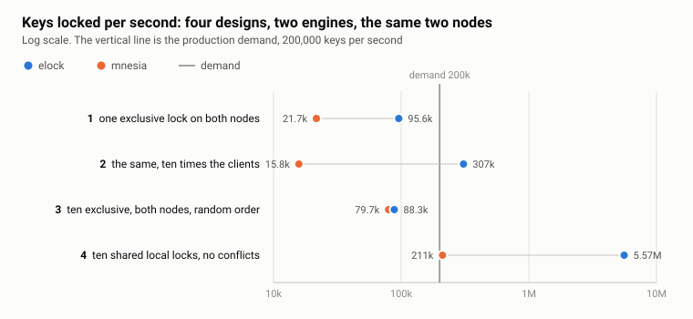

# elock: scalable distributed locks with deadlock detection.

*[elock](https://github.com/vzroman/elock) is a lock library for Erlang: locks on any term, exclusive or shared, on one node or on several at once, with deadlocks detected across nodes.*


The runs behind every number here: two hosts with two Xeon Gold 6342 sockets each, 48 cores, hyper-threading off, a 10 GbE bond between them, one Erlang 27.2.2 node per host in a Docker container, driven by Common Test from a third machine. 10,000 clients per node unless said otherwise, over a pool of 5 million objects, 20 million locks per point. mnesia and global are in the tables as the two lock engines that ship with OTP. The suite is in the repository under `test/performance`.

## What elock does

The library is small, and the part that decides the numbers is smaller.

**A lock is an ETS row, and a ticket is the only synchronization.** A scope is a public ETS table. A lock on a term is a row in it: the term, the pid of its manager, and a counter. To ask for the lock, the caller increments the counter:

```erlang
lock(#request{scope = Scope, term = Term} = Request, OnQueued) ->
  case ets:update_counter(Scope, Term, {3, 1}, {Term, 0, 0}) of
    1 ->
      % the row was free: the caller holds the lock from this moment
      Manager = start_manager(Request),
      {ok, Manager};
    Ticket ->
      % somebody holds it: queue behind them, in ticket order
      Manager = get_manager(Scope, Term, Ticket),
      Manager ! Request#request{ticket = Ticket, proxy = self()},
      wait_verdict(Manager, OnQueued, Request)
  end.
```

Ticket 1 means the row was free: the caller holds the lock the moment the counter returns and spawns a manager for the term. Any later ticket means somebody holds it: the caller sends its request to the manager and waits for a verdict, `locked`, `timeout` or `deadlock`. The uncontended path is one atomic counter update in the caller, about 17 µs of scheduler time, and it is why both nodes were at 99.8 percent in the figure above: every core was taking locks, because nothing stood in the way. mnesia's 11 percent in the same figure is its locker, one process per node, that every request calls whether the key is free or not.

**A manager per locked term, for as long as it is locked.** The manager keeps the queue in ticket order and grants in that order. A shared request joins the shared holders at once only while nobody is waiting, so a stream of readers cannot starve a writer. When the last holder leaves and nobody waits, the manager deletes the row and exits. Contention on a hot term is one process on one scheduler; two hot terms are two processes on two schedulers.

**A request for several nodes is one worker per node.** Each worker asks its node. All nodes are asked at once; the request holds the nodes that have granted it while it waits for the rest, and if any node fails the granted ones are released, so the result is all or nothing. A remote worker stays alive after the grant as the lock's representative on the client's node: it monitors the client and sends the release when the client exits.

**Deadlock detection.** Only a request that has to wait while its process already holds something can deadlock, and only such a request pays for detection. It gets a graph worker, spawned when the manager reports it queued. The worker publishes the process's holds into a wait-for graph that every node keeps in a public ETS table, and every new edge starts a walk from it, expanding locks on their own node and hopping to the other nodes with one cast per node. A walk that comes back to its origin has found a cycle, and the request of the younger context loses: it gets `{error, {deadlock, Lock}}`, keeps what it holds, and the caller decides, typically release and repeat. A walk has a limit on the locks it visits, past which the origin loses with `probe_limit` rather than let the walk become the cost.

**Locks die with their holder.** A local holder is monitored by its manager, a remote one by its worker, and every node drops the locks of the clients of a node that has gone down. A process that crashes while holding locks leaves no lock behind.

## Distributed locks

Now every write takes an exclusive lock on its key on both nodes, writes, releases: 10,000 clients per node with 1,000 transactions each, then 100,000 clients per node with 100 each, the same 20 million locks.


mnesia has three limits in its way, one behind the other: the locker, one process per node that every request goes through whether the key is free or not; the distribution queue, one per node pair, that every cross-node signal enters one at a time; and the wire. Ten times the clients gave it a quarter less throughput, 12 second transactions and 10 GB of memory per node. global's `set_lock` is a cluster-wide protocol with retries: 16 seconds per lock, 4.4 hours for the run, and we did not run it with ten times the clients.

elock has no locker, and its cross-node traffic rides [ecall](https://github.com/vzroman/ecall), which enters the distribution queue once per batch rather than once per signal: ten times the clients gave three times the locks, and the batches got cheaper per lock as they grew. What is left is the wire. A cross-node lock is a round trip, 208 ms at 10,000 clients per node, and a client spends its time waiting for it while the nodes sit three quarters idle. More clients means more round trips in flight, not a shorter one.

elock can take the waiting out entirely, or cut it down a lot, but in the end that depends on the design of your system. The rest of this article is how we came to the 5.5 million figure in our production system.

## Our production system and its demand

The system is the SCADA/EMS we built for KEGOC, Kazakhstan's national electricity grid operator, described in the [discussion](https://erlangforums.com/t/ecall-batched-pooled-send-cast-call-over-erlang-distribution-scales-past-the-single-output-queue-per-node-pair/5940/10) under the previous article.

The unit of information is a tag, much like a classic SCADA tag. Tags are data, not processes: records with a schema in a database engine that supports subscriptions, to a tag or to a query. The processes are the actors, the runtime services that read and write tags. The most typical of them:

- **A device connection.** One process per connection to a field device, a PLC, an energy meter, any smart device. It receives updates from the device and writes them into the tags, and writes some points back, setpoints, PID settings and the like.
- **A user script.** It subscribes to its input fields, recalculates when they change, and writes the results to its output fields.
- **An archive.** It subscribes to its source tags and hands the values to a pool of writers in front of a time-sharded RocksDB store.
- **A user session.** One process per browser connection, subscribed to the tags on the open screen. A writer only when the user changes a setpoint or a setting.
- **High-level services.** The state estimation engine, prediction, the electricity grid graph, AI agents, the dispatcher assistant among them. Mainly consumers, with occasional writes back.

A signal typically travels like this. A device connection reads its addresses and writes the values into its tags. A calculation or a user script subscribes to some of those tags and writes its results into tags of its own, and the archive and the alarm service subscribe to the results. Every heavy writer on that path owns the tags it writes, the tags of its device or the outputs of its script, and no two of them write the same tag. The occasional writers are off the path: a user session or the state estimation engine can subscribe to any tag and write to any tag.


A node runs a large population of such actors, each quiet until its device, its inputs or its user has something new, and most of them are both producers and consumers. A write does not stop at the node where it happened: it is shipped to the neighbouring nodes, and on every node the engine fans it out to the local subscribers. Actors have to synchronise over the tags they write, so there are locks, and every lock that spans nodes crosses the same channel as the writes.

The demand: a pool of 5 million real-time objects, about 10,000 actors per node over them, each writing about ten objects per second. That is 200,000 keys per second across the cluster, and the number every design below is measured against.

## Design 1: one exclusive lock on both nodes, per write

We started with the simplest thing that is correct. Each actor, for each key it writes, takes an exclusive lock on both nodes, writes, releases. In the suite that is 10,000 clients per node with 1,000 transactions each, one key per transaction: 20 million locks.

elock gave 95,600 keys per second, under half of the 200,000 we need. mnesia gave 21,700, a tenth of it. global gave 1,265, with 16 seconds per lock and 4.4 hours for the run, and we did not run it again. None of them was short of CPU: elock left the nodes three quarters idle, because the clients were not computing. 20,000 of them were waiting for round trips, 208 ms each with elock, and the throughput was how many of those the link completed per second.

## Design 2: ten times the actors

If the limit is the round trip, put more clients on it. We ran 100,000 clients per node with 100 transactions each, the same 20 million locks. elock scaled: 307,000 keys per second, the demand met with half as much again to spare, and the batches on the link got cheaper per lock as they grew. mnesia went backwards, to 15,800, with 12 second transactions and 10 GB of memory per node.

That was the first design to meet the demand, and we did not take it. Ten times the actors is not a parameter of our system, it is a rewrite of it: the device connections, scripts and archives would be split into pieces that have no reason to exist except to lock in parallel. And the capacity it left was thin.

## Design 3: batches, in random order

The next idea was that writing in batches is cheaper, which for the store it is: one transaction of ten keys costs less than ten transactions of one. So we took our 10,000 clients back and let each of them lock ten keys exclusively on both nodes, write, release. A real actor may not know in advance which keys it will need, so the harness takes them in random order. 100 transactions per client, the same 20 million locks.

elock's lock rate held, 88,300 keys per second, eight percent under design 1. Ten keys are still ten round trips, so a transaction took 2.2 seconds, 224 ms per key against 208: the batch bought the store something and the actor nothing. The eight percent is the chain. A transaction with six of its ten locks waiting for the seventh holds six keys that other transactions wait for, and they hold theirs. One percent of the transactions closed a cycle and were restarted; the rest paid for the chains, with the schedulers at 17 percent.

mnesia surprised us by speeding up, to 79,700, and stayed behind. Its locker prevents deadlocks instead of detecting them: a younger transaction asking for a lock held by an older one is restarted. Under random-order batches that rule fires constantly, and it restarted 30 percent of all transactions at a scheduler cost of 4 percent, because a restarted transaction does nothing but wait and try again. The harness makes a restart free. A production system does not: a restarted transaction has done its reads, perhaps its computation, and does them again.

 Design 3 builds chains by construction, and a system that does that is not helped by an engine, however scalable. What had to change was the design of the system.

## Design 4: heavy writers lock locally, rare writers lock everywhere

The next approach came from the shape of our own traffic, the picture above. About 99 percent of the writes come from the heavy runtime services, the device connections, the calculations, the user scripts, and each of them writes a set of tags that is known in advance and overlaps with no other service's set: a PLC connection writes the tags of its PLC, a script writes its own outputs. The remaining percent comes from the occasional writers, a user changing a setpoint, the state estimation engine, the grid graph, an AI agent. Those can touch any tag, including the tags a heavy service owns, so the two kinds of writer still have to synchronise. Heavy services do not have to synchronise with each other at all.

So a heavy write does not need a lock that crosses the link. It needs a lock the occasional writer will run into, and the occasional writer can come to the service's node for it. The one condition is that a service runs on one node at a time, so that there is one node to come to. How a service gets its node is a separate matter, below; for the numbers it only matters that it has one.

**Heavy writes under shared local locks, in batches.** A service writes its tags under a shared lock on each key, on its own node only. Shared, because the only conflict a heavy write can have is with an occasional writer, and shared holders never wait for each other. Local, because that is where the occasional writer's exclusive request will arrive. Between occasional writes, which is nearly always, the service's shared requests are granted at once, by the caller itself.

**Occasional writes under exclusive locks on every node.** An occasional writer takes an exclusive lock on each key it writes, on every node. On the heavy service's node it queues behind the shared holders of that key and is granted when they release; the service's next shared request on that key queues behind it. That is the whole synchronisation between the two kinds of writer, and it is paid by the rare one.


The heavy path in the suite: 10,000 clients per node, 100 transactions each, ten shared local locks per transaction on keys nobody else touches, which is what disjoint sets mean. The same 20 million locks, done in 3.6 seconds: 5.57 million keys per second, 28 times the demand, with no traffic on the link and both nodes 99.8 percent busy with the work the benchmark asked for. The 30 ms of a transaction is 10,000 runnable clients sharing 48 cores, not the locks. mnesia took 95 seconds for the same run, 211,000 keys per second at 11 percent busy: 10,000 clients queued behind its locker. The occasional path is design 1, 95,000 exclusive two-node locks per second, which for one percent of the traffic is a ceiling we will not see.

A third node, by the same reasoning, adds its own heavy capacity, since every heavy lock is local. What crosses the link is the occasional writers, which lock on every node and get slower by a node, and the service locks at start. We have not measured it, and it is the claim we would test first.



## Which node runs the service

The condition in design 4, one node per service, is usually configuration: which service runs on which node, and a procedure for when that node is down. We wrote neither. Every node starts every configured service. On start, each service asks for an exclusive lock on its service object, the PLC connection object, the script object, on every node. The service that gets the lock keeps it and does the work for its set of tags. The service that does not get it waits inside the request, holding nothing. The request is a loop: when it returns an error, because a node went away, the service re-reads the ready nodes and asks again. One cross-node exclusive lock per service, once, at start.


This decides none of the numbers above; a static assignment would have measured the same. It decided what we did not have to build. The work balances itself across the nodes: which node runs which service is decided by who wins the lock, and a node that is added takes the services whose locks it gets. And every service has a standby: when a service dies, or its node does, its locks are released, the partner on the neighbouring node that has been waiting inside its request gets the lock and continues the work. The retry loop and the property that locks die with their holder are the whole mechanism; there is no placement table and no failover code.

## Takeaways

Every item here is the lede again: a granted lock costs microseconds, a waiting one costs the wait, and everything its holder holds waits with it.

- **Do not lock what does not need locking.** The cheapest lock is the one you never take. A writer whose keys nobody else ever touches needs no lock on them at all. Look for such writers in your traffic first.
- **Use the cheapest lock that is correct, above all on the common path.** Shared local, exclusive local, exclusive across nodes, in that order. Put the common path on the lowest rung and move the expensive locks to the rare writers: in design 4 the occasional writer pays the cross-node exclusive lock so that the heavy ones never do.
- **Keep the chains short.** While you hold something, everybody behind it waits with you, on one node as on two. Do not hold a lock across a round trip or a long computation, and where you can, take the locks first and do the work after, so that a restart throws away a wait and not the work.
- **Avoid deadlocks by construction.** If the keys are known ahead, lock them in sorted order and a cycle cannot form. If they are not, as in design 3, expect cycles and price the restart honestly: it is free in a harness and never in production.
- **Use elock :)** 

The library, with its performance suite, is at [github.com/vzroman/elock](https://github.com/vzroman/elock).
